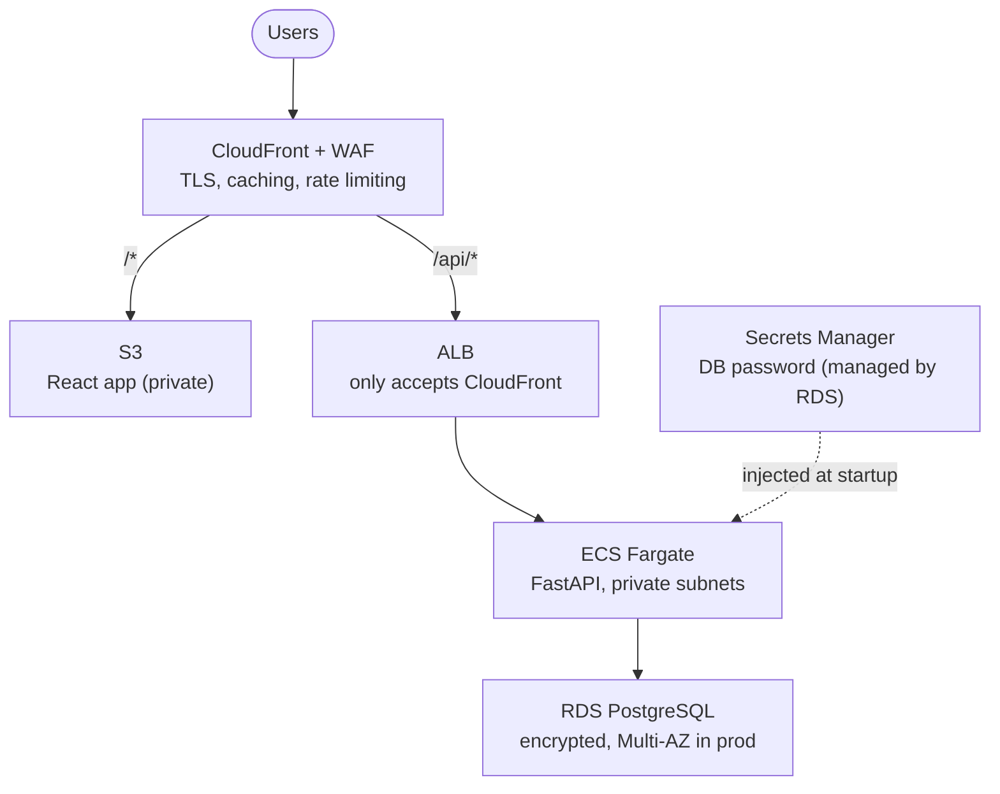
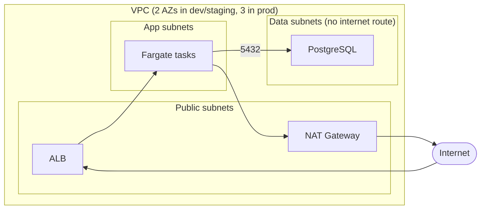

# LexiCheck

A small spell-checker web app, and a production-style AWS setup to run it.

Paste some text, pick a language, and every misspelled word gets a wavy red underline. Click a word and choose a fix from the margin. It supports English, Spanish, French, German, Italian and Portuguese.


Under the hood there's no AI model. It uses [pyspellchecker](https://github.com/barrust/pyspellchecker), which follows Peter Norvig's classic approach: words not in the language's dictionary get flagged, and suggestions are dictionary words one or two edits away, ranked by how common they are. You pick the language yourself, nothing is auto-detected. It's fast, cheap and predictable, but it won't catch a real word used in the wrong place ("their" vs "there").

The app is deliberately simple. The point of the repo is everything around it: Terraform modules, a CI/CD pipeline with dev, staging and prod, zero-downtime deploys, and monitoring.

---

## Architecture

### Traffic flow



The browser only ever talks to CloudFront. Static files come from S3, and anything under `/api` goes to the load balancer. The ALB's security group only allows CloudFront's IP ranges, and it also checks a secret header, so the WAF can't be bypassed.

### VPC layout



A few decisions worth mentioning:

- **Fargate on ARM.** No servers to patch, and it's cheaper than x86. It autoscales on CPU and on requests per task.
- **No passwords anywhere.** RDS creates and rotates its own master password in Secrets Manager. It never shows up in Terraform state, variables or CI.
- **No AWS keys in GitHub.** Actions logs in through OIDC, and each environment has its own role.
- **Cheap where it can be.** Dev and staging use one NAT gateway, Fargate Spot and a single-AZ database. Prod gets a NAT per AZ, Multi-AZ RDS and longer backups.

---

## Getting started

### Local

You'll need Docker. For hot-reload development you also need [uv](https://docs.astral.sh/uv/) and Node 24. Run `make help` to see every command.

```bash
# Whole stack: nginx + API + Postgres
make up
# App: http://localhost:8081

# Same stack plus Prometheus and Grafana
make up-obs
# Prometheus: http://localhost:9090
# Grafana:    http://localhost:3000

# Hot reload: API on :8080, web on :5173
make install
make dev

# Lint, tests and terraform validate, same checks as CI
make check

# Trivy security scans (runs in Docker, nothing to install)
make scan

# Stop everything and remove the data
make down
```

### AWS

#### Prerequisites

1. AWS credentials loaded (`export AWS_PROFILE=...`). Check with `make aws-whoami`.
2. Terraform >= 1.10. The S3 backend uses the native lockfile (`use_lockfile`), so you don't need a DynamoDB table.

#### Deploy

```bash
# Once per account: S3 bucket for Terraform state (encrypted, versioned, TLS only)
make aws-bootstrap

# Once per account: $20/month budget, emails you at 80% (actual or forecast) and 100%
make aws-budget EMAIL=you@example.com

# Infra + image + frontend + smoke test (~20 min, CloudFront and RDS are slow)
make aws-up
# Prints the CloudFront URL at the end, e.g. https://d1234abcd.cloudfront.net

# Tear it all down again
make aws-down
```

`ENV` defaults to `dev`. Use `ENV=staging` or `ENV=prod` for the others. All three can share one AWS account, because names, CIDRs and state files are separate per environment.

#### CI/CD

Once the infra exists, GitHub Actions takes over:

- **Pull requests** run lint, tests, the frontend build, `terraform validate`, security scans and a docker-compose smoke test. If you touched `infra/`, the Terraform plan is posted as a comment.
- **Merging to main** builds the image once (tagged with the commit SHA) and promotes it through dev, then staging, then prod. Prod waits for a manual approval.
- **Rollback.** Run the *Release* workflow with an older `image_tag`. On top of that, ECS rolls back automatically if new tasks never become healthy.

To connect it, create the GitHub environments `dev`, `staging` and `prod`. Fill their variables from `terraform output deploy` (role ARN, ECR URL, cluster, service, bucket, distribution ID, URL), then set the repo variable `AWS_DEPLOY_ENABLED=true`. Until you do, pushes only run CI.

### Security scanning

[Trivy](https://trivy.dev) runs on every pull request, and the build fails on any HIGH or CRITICAL finding:

| Scan | Looks for |
|---|---|
| `config` | Terraform misconfigurations (open security groups, unencrypted resources...) |
| `fs` | Known CVEs in `uv.lock` and `package-lock.json`, and secrets committed by mistake |
| `image` | CVEs in the API container (OS packages and Python libraries) |

Accepted findings live in [`.trivyignore`](.trivyignore), each with a one-line reason. To keep the image clean, the runtime stage also strips out pip, since the app runs from the uv-built virtualenv.

---

## Observability

- The API exposes Prometheus metrics at `/metrics`: requests, latency per route, words checked and errors found per language.
- `ops/` has the Prometheus config, a Grafana dashboard and alerts: 5xx rate above 1%, p95 above 500 ms, API down.
- In AWS: CloudWatch alarms (5xx, latency, unhealthy tasks, DB CPU and disk) send to SNS, plus Container Insights and VPC flow logs.
- Health checks: `/healthz` tells the ALB the process is alive, and `/readyz` also checks the database.

---

## File map

```
api/                      FastAPI service (Python 3.14, uv, ruff, pytest)
  src/lexicheck/          app, spell checker, DB, metrics
web/                      React + Vite+ frontend
ops/                      Prometheus, alerts, Grafana dashboard
compose.yaml              local stack
Makefile                  every command you need

infra/terraform/
  modules/
    network/              VPC, subnets, NAT, flow logs
    database/             RDS Postgres + KMS
    service/              ECR, ALB, ECS, IAM, autoscaling
    edge/                 S3, CloudFront, WAF
    alarms/               CloudWatch alarms -> SNS
    budget/               monthly cost budget with email alerts
    stack/                wires it all together + GitHub deploy role
  envs/dev|staging|prod/  one small root per environment
  envs/account/           account-wide things (the budget), separate state

  Every folder: main.tf, variables.tf, outputs.tf and versions.tf (provider version
  ranges, e.g. aws >= 5.60, < 6.0). Env roots also have providers.tf.
  Lock files aren't committed; `terraform init` resolves within those ranges.

.github/workflows/
  ci.yaml                 checks on every PR
  release.yaml            build once, promote dev -> staging -> prod
  deploy-env.yaml         deploy to one environment (reused)
  infra.yaml              terraform plan on PR, apply on main
```
