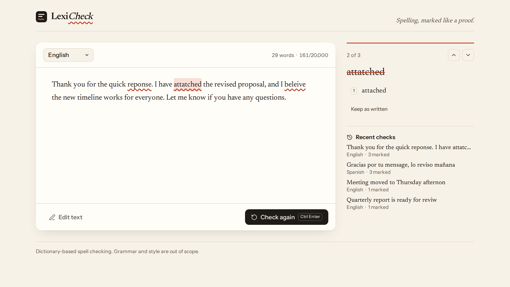
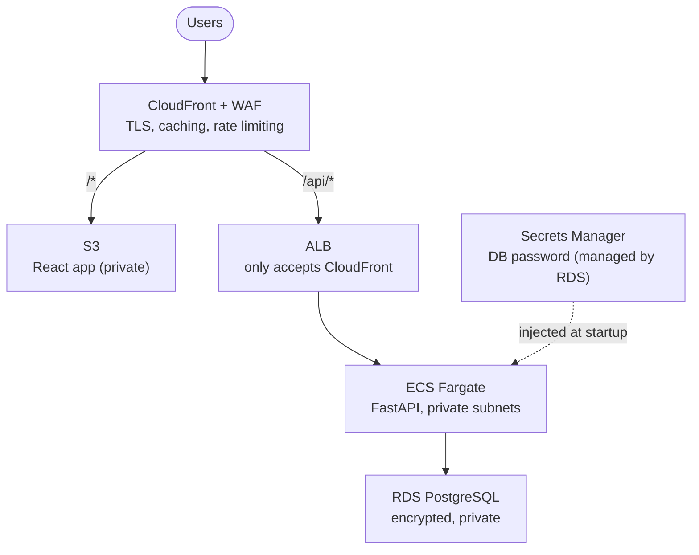
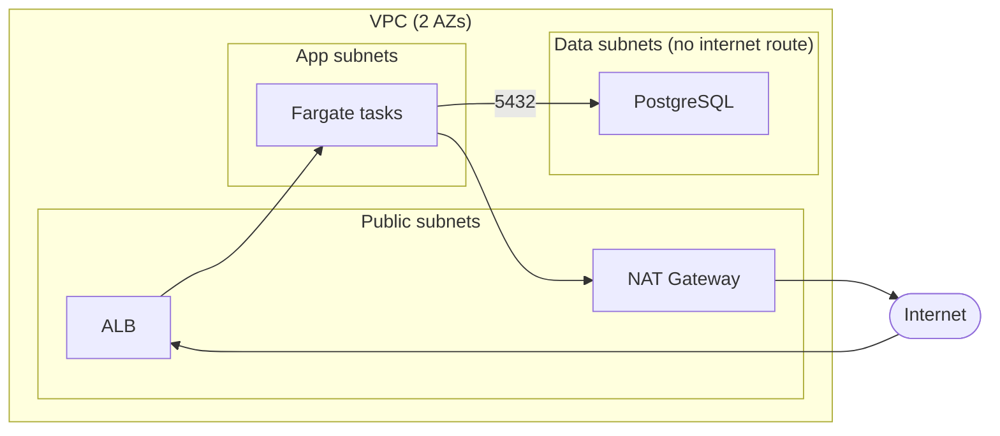

# LexiCheck

A small spell-checker web app, and a production-style AWS setup to run it.

Paste some text, pick a language, and every misspelled word gets a wavy red underline. Click a word and choose a fix from the margin. It supports English, Spanish, French, German, Italian and Portuguese.



Under the hood the spell checker doesn't use AI. It uses [pyspellchecker](https://github.com/barrust/pyspellchecker), which follows Peter Norvig's classic approach: words not in the language's dictionary get flagged, and suggestions are dictionary words one or two edits away, ranked by how common they are. You pick the language yourself, nothing is auto-detected. It's fast, free and predictable, but it won't catch a real word used in the wrong place ("their" vs "there").

For fun there's also **Rewrite with AI**: pick a style (rhyming poem, pirate, Shakespeare, formal, haiku, emoji) and an OpenAI model fixes the spelling and rewrites the text that way. It's optional. Without an `OPENAI_API_KEY` the button simply doesn't show up.

The app is deliberately simple. The point of the repo is everything around it: Terraform modules, a GitHub Actions pipeline that deploys to AWS without any stored keys, zero-downtime deploys, security scanning and monitoring.

---

## Architecture

### Traffic flow



The browser only ever talks to CloudFront. Static files come from S3, and anything under `/api` goes to the load balancer. The ALB's security group only allows CloudFront's IP ranges, and it also checks a secret header, so the WAF can't be bypassed.

### VPC layout



A few decisions worth mentioning:

- **Fargate on ARM.** No servers to patch, and it's cheaper than x86. It autoscales on CPU and on requests per task.
- **No passwords anywhere.** RDS creates and rotates its own master password in Secrets Manager. It never shows up in Terraform state, variables or CI.
- **No AWS keys in GitHub.** Actions logs in through OIDC, and each environment has its own role.
- **Cheap where it can be.** One NAT gateway, Fargate Spot and the smallest single-AZ database. The same modules switch to a NAT per AZ, Multi-AZ RDS and longer backups when `environment` is `prod`.

---

## Getting started

### Local

You'll need Docker. For hot-reload development you also need [uv](https://docs.astral.sh/uv/) and Node 24. Run `make help` to see every command. To try the AI rewrite locally, put `export OPENAI_API_KEY=...` in a `.env.aws` file at the repo root (gitignored); the Makefile picks it up.

```bash
# Whole stack: nginx + API + Postgres
make up
# App: http://localhost:8081

# Same stack plus Prometheus and Grafana
make up-obs
# Prometheus: http://localhost:9090
# Grafana:    http://localhost:3000

# Hot reload: API on :8080, web on :5173
make install
make dev

# Lint, tests and terraform validate, same checks as CI
make check

# Trivy security scans (runs in Docker, nothing to install)
make scan

# Stop everything and remove the data
make down
```

### AWS

Everything runs in one AWS account and one environment (`dev`). The Terraform is split into reusable modules, so adding a staging or prod root later means copying `envs/dev`.

#### Prerequisites

1. AWS credentials on your machine: `export AWS_PROFILE=...`, or `export AWS_ACCESS_KEY_ID=...` lines in a `.env.aws` file at the repo root (gitignored, the Makefile loads it). Check with `make aws-whoami`.
2. Terraform >= 1.10, and the GitHub CLI (`gh`) logged in.

#### First deploy (from your machine)

```bash
# S3 bucket for Terraform state: encrypted, versioned, TLS only, native lockfile
make aws-bootstrap

# Account-wide: $20/month budget (emails at 80% and 100%) and the roles GitHub uses
make aws-account EMAIL=you@example.com

# Infra + image + frontend + smoke test (~20 min, CloudFront and RDS are slow)
make aws-up
# Prints the CloudFront URL at the end, e.g. https://d1234abcd.cloudfront.net

# Optional: turn on AI rewrites (reads OPENAI_API_KEY from .env.aws)
make aws-openai-key
```

#### Hand it over to GitHub Actions

```bash
make gh-setup
```

This creates the GitHub environments and fills in their variables from `terraform output`. **No secrets involved:** GitHub logs in to AWS through OIDC and gets short-lived credentials, and each role only trusts tokens from this repo.

| AWS role | Used by | Trusts |
|---|---|---|
| `lexicheck-dev-github-deploy` | Release (ECR, ECS, S3) | the `dev` environment |
| `lexicheck-github-tf-plan` | Terraform plan on PRs | any branch, read-only |
| `lexicheck-github-tf-apply` | Terraform apply | the `infra` environment, main branch only |

The variables (role ARNs, bucket and cluster names, URL) aren't sensitive, and they live in GitHub, not in git.

From then on:

- **Pull requests** run lint, tests, the frontend build, `terraform validate`, Trivy and a docker-compose smoke test. If you touched `infra/`, the Terraform plan is posted as a comment.
- **Merging to main** only deploys what changed:
  - `api/` or `web/` changed: run CI, build the ARM64 image on an ARM runner, push it to ECR tagged with the commit SHA, roll ECS over to it, publish the frontend to S3 and smoke test the live URL.
  - `infra/terraform/` changed: `terraform apply`.
  - Docs or images only: nothing runs.
- **Rollback.** Run the *Release* workflow by hand with an older `image_tag`. ECS also rolls back on its own if new tasks never get healthy.

#### Tear down

```bash
make gh-disconnect   # stop GitHub from deploying
make aws-down        # destroy the environment
```

The budget and CI roles stay, since they cost nothing. If you're done for good, `make aws-delete-state` removes the state bucket.

### AI rewrite

The rewrite endpoint calls a paid API from a public website, so it has a few guards:

- **The key never touches git, CI or Terraform state.** Terraform creates an empty Secrets Manager secret, `make aws-openai-key` writes the value from your local `.env.aws`, and ECS injects it into the API container at startup.
- **Small and cheap by default.** `gpt-4o-mini`, at most 1,000 characters in and 300 tokens out (around 100 to 200 tokens per rewrite in practice).
- **Rate limited at the edge.** A dedicated WAF rule allows 10 rewrites per IP per minute and answers 429 above that, before the request reaches the API.
- **Tested without spending anything.** The tests swap OpenAI for a fake HTTP transport.
- **Visible.** Rewrites and tokens used show up as Prometheus metrics (`lexicheck_rewrites_total`, `lexicheck_ai_tokens_total`).

It's also worth setting a monthly spend limit on the OpenAI project itself. That's the one guard this repo can't set for you.

### Security scanning

[Trivy](https://trivy.dev) runs on every pull request, and the build fails on any HIGH or CRITICAL finding:

| Scan | Looks for |
|---|---|
| `config` | Terraform misconfigurations (open security groups, unencrypted resources...) |
| `fs` | Known CVEs in `uv.lock` and `package-lock.json`, and secrets committed by mistake |
| `image` | CVEs in the API container (OS packages and Python libraries) |

Accepted findings live in [`.trivyignore`](.trivyignore), each with a one-line reason. To keep the image clean, the runtime stage also strips out pip, since the app runs from the uv-built virtualenv.

---

## Observability

- The API exposes Prometheus metrics at `/metrics`: requests, latency per route, words checked and errors found per language.
- `ops/` has the Prometheus config, a Grafana dashboard and alerts: 5xx rate above 1%, p95 above 500 ms, API down.
- In AWS: CloudWatch alarms (5xx, latency, unhealthy tasks, DB CPU and disk) send to SNS, plus Container Insights and VPC flow logs.
- Health checks: `/healthz` tells the ALB the process is alive, and `/readyz` also checks the database.

---

## File map

```
api/                      FastAPI service (Python 3.14, uv, ruff, pytest)
  src/lexicheck/          app, spell checker, AI rewriter, DB, metrics
web/                      React + Vite+ frontend
ops/                      Prometheus, alerts, Grafana dashboard
compose.yaml              local stack
Makefile                  every command you need

infra/terraform/
  modules/
    network/              VPC, subnets, NAT, flow logs
    database/             RDS Postgres + KMS
    service/              ECR, ALB, ECS, IAM, autoscaling
    edge/                 S3, CloudFront, WAF
    alarms/               CloudWatch alarms -> SNS
    budget/               monthly cost budget with email alerts
    ci-roles/             OIDC roles GitHub uses to run Terraform
    stack/                wires it all together + GitHub deploy role
  envs/dev/               the environment
  envs/account/           account-wide things (budget, CI roles), separate state

  Every folder: main.tf, variables.tf, outputs.tf and versions.tf (provider version
  ranges, e.g. aws >= 5.60, < 6.0). Env roots also have providers.tf.
  Lock files aren't committed; `terraform init` resolves within those ranges.

.github/workflows/
  ci.yaml                 checks on every PR
  release.yaml            build the image, deploy to ECS + S3, smoke test
  infra.yaml              terraform plan on PR, apply on main
```
